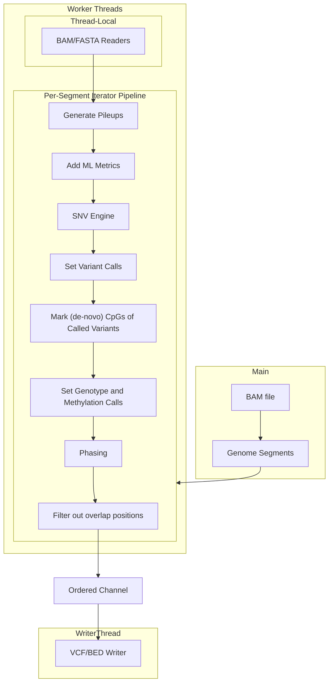

# Rastair Architecture

Rastair performs simultaneous variant and methylation calling from @TAPS sequencing data.
This section describes three key architectural components that enable the robust and performant genome-wide analysis.

## Parallel Pipelined Iterator

Rastair processes genomic data through a parallel architecture
that maintains positional context
while achieving efficient CPU utilization at low memory usage (see [compute resources](compute-resources.md)).

**Segmentation**:
The genome is divided into overlapping segments (`--segment-max-length`, 100 kb by default, overlapping by `--segment-overlap`, 200 bases).
Each segment has a "core" region flanked by "overlap" regions.
This design ensures that positions at segment boundaries have access to adjacent positions needed for CpG pair analysis and de-novo CpG detection.
After processing, only core positions are emitted, preventing duplicates.

**Thread-Local Readers**:
Each worker thread maintains its own @BAM and @FASTA file handles, avoiding lock contention and serialize I/O.
Index files (BAI or CSI for a BAM, CRAI for a CRAM, FAI for the FASTA) enable efficient parallel random access.

**In-Order Results**:
When a worker takes a segment, it also queues a one-shot channel for that segment's result, so the writer receives results in segment order without reordering them.
The queue holds at most 4 segments per worker: once it is full, workers wait for the writer before starting another segment.
One slow segment (deep coverage, a repeat) therefore holds back at most that many finished results, not every segment after it.
This preserves the strict genomic coordinate ordering required by @VCF format.

**Iterator Pipeline**:
Within each worker, a segment's columns pass through these steps in order:

1. **Pileup generation**: Extract reads from @BAM and build per-position summaries (depth, allele frequencies, quality scores, strand counts); a column with no alt, no indel and no (possible @denovo) @CpG is dropped before it is finished (context-aware), and the indels are called by the pair-HMM
2. **Add @ML metrics** (context-aware): Random Forest scoring using current and adjacent positions
3. **SNV engine**: The pair-HMM scores the alts the forests kept, and a second set of forests scores them again
4. **Set variant calls**: Call the alts the forests pass and the pair-HMM's genotype holds, and genotype them
5. **Mark called CpGs** (context-aware): The @denovo CpGs called variants make with their neighbours
6. **Calls**: The genotype of positions without a variant, and @methylation calls
7. **Phasing**: Link heterozygous sites into phase blocks, anchored on the positions the segment emits
8. **Core filter**: Remove overlap positions

The "context-aware" steps are processed with parameters for the pileup metrics for the current position as well as the ones before and after.
This enables @CpG pair coordination and @denovo detection.

<!--
Diagram ideas:
- Flowchart showing iterator stages with data flow
- Architecture diagram showing threads + in-order result queue
- Sequence diagram showing data transformation through pipeline
-->

## Output Formats

Rastair's internal representation is converted to standard bioinformatics formats for downstream analysis.

### VCF Conversion

Each position generates @VCF records during writer thread processing:
- **One primary record**: Contains the called alternative alleles. A @CpG site without a called variant gets a ref-only record (REF→`.`).
- **Indel records**: Each called indel allele, or two at one position, is its own record.
- **Rejected alleles**: Under `--all`, each alternative allele that was not called is written as its own record with the filter that rejected it (`pre_ml`, `m_highDp`, `low_ml_score`, `no_genotype_copy`, or `low_indel_qual` for an indel).
- **Fields**: FORMAT holds the genotype (`GT`, `GQ`, `PL`, from the pair-HMM, see [genotyping](calling/genotyping.md)), the @ML score and the methylation beta (`M5mC`); INFO holds depth metrics, allele frequencies, strand bias statistics, and the CpG and de-novo CpG flags (see [VCF fields](formats/vcf-fields.md)).

### BED Format

Compact TSV format for methylation data.
Each line represents a single CpG position with its methylation beta, read counts and genotype (see [BED](formats/bed.md)).
Best for methylation-focused downstream analyses.

## Machine Learning Integration

Random Forest models disambiguate true variants from sequencing errors and methylation artifacts.

**Three Separate Models**: Different variant contexts require different discriminatory features:
- **CpG model**: C→T or G→A at canonical CpG sites
- **De-novo CpG model**: Variants creating new CpG sites
- **Others model**: Non-CpG variants

A second set of the same three models scores the alleles again once the pair-HMM has scored them, with its evidence (`--snv-engine`, see [ML](calling/ml.md)).

Models are bundled as one compressed file.
A default model file is bundled in the Rastair binary and loaded at startup.
Custom models for domain-specific tuning can be created with `rastair ml train` and then passed with `--model`.
