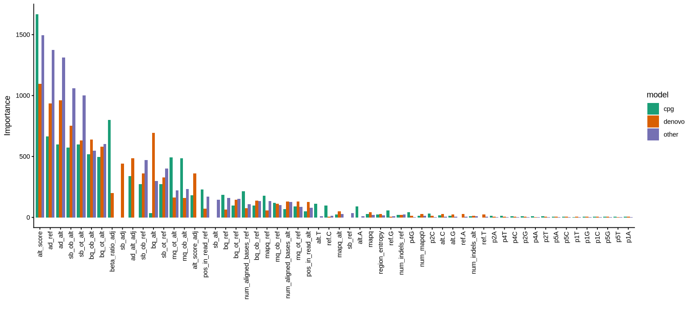

# Machine Learning Models

Rastair uses @ML to distinguish true @methylation calls and variants from sequencing artifacts (and noise).
The ML models evaluate each alt at each position and assign a prediction score for that alt to be a true variant.

By default, ML is enabled with a threshold of `0.5`.
Pre-trained models are bundled with Rastair.

These models handle several contexts with distinct sub-models:

- **@CpG methylation sites**: Standard 5mC detection in @CpG sites
- **@Denovo**: New methylation sites not in reference
- **Other variants**: Non-CpG @SNP:pl

Some features are shared across models, but some are model specific. Here is a plot of all features used in each model, ranked by importance:



Here, `_adj` refers to a feature of the `adjacent` nucleotide, _ie_ the C when evaluating a G or the G when evaluating a C. All scores that refer to allele counts are normalised either implicitly (where the score itself is a ratio) or explicitly to the total depth at that position. Of note, the `alt_score` is a simple ratiometric score to establish the base-quality weighted enrichment of variant reads over non-variant reads: $$ altscore = \frac{log_{2}(sb_{alt}*bq_{alt}+1)}{log_{2}(sb_{ref}*bq_{ref}+1)} $$, where $sb_{ref/alt}$ refers to the number of reads with ref/alt on the OT (for C positions) or OB (for G positions), and $bq_{ref/alt}$ is the corresponding strand-specific @RMS of base qualities.

The resulting ML scores are calibrated using [Platt scaling](https://en.wikipedia.org/wiki/Platt_scaling), which normalizes score distributions across the three separate sub-models.

## Haplotype likelihood features

`ml train --ml-features haplotypes` trains the three SNV forests (CpG, de-novo CpG and other) with 13 molecular features appended to each existing feature layout, every one a probability, a fraction of the site's molecules or a per-molecule mean rather than a count, so that a forest trained at one sequencing depth does not learn that depth; indels have no forest, the [pair-HMM](indels.md) calls them. A model's metadata selects this feature path automatically when loaded with `call --model FILE`, on both BAM backends. `--phase` is only needed to write phased genotypes and phase sets. The bundled model remains unchanged until the new model has passed held-out validation.

Features are calculated before output selection, ML filtering and genotype calling, so final phase calls cannot feed back into their own filters. CpG-only output retains neighboring SNPs for likelihood calculation. Observed alleles enter the search: every alternate base with at least two supporting reads whose TAPS-informative strand does not rule a heterozygote out (a binomial test at a 40 % allele fraction, P < 0.01, needing at least three reads on that strand: at a `C` only OB reads can show a `T` that is not a converted methylated `C`, at a `G` only OT reads an `A`, and a true `C` or `G` allele is only seen unconverted on the strand that does not convert it), and every indel allele with two supporting reads as context on the chromosomes. Without that gate the regional model scored every column with a mismatching read, 39,000 sites per Mb at 26x, most of them single reads and methylated CpGs. Observed sites that are not candidates are kept as context within 150 bp of a candidate. Diploid chromosome likelihoods jointly marginalize neighboring SNP assignments and compatible indels at multiple anchors. SNP features summarize alternate-presence, heterozygous and homozygous probabilities, expected allele fraction, a log Bayes factor, genotype entropy, context size, linking molecules, scored molecules, realignment fraction and search pruning, and three prior-free views of the same matrix: the homozygous fraction of the allele's own posterior, and the number and fraction of informative molecules the best allele-carrying chromosome pair assigns to the carrying chromosome (GATK's allele depth, counting a molecule where its two chromosome likelihoods differ by more than a fifth of a decade). Separate availability and boundary-resolution fields distinguish missing evidence from evidence against an allele.

Training and calling share the likelihood configuration: 0.95 TAPS conversion, 0.003 background conversion, shared per-CpG Beta(2,2) shrinkage with leave-one-molecule-out estimation, template padding of 12 bases plus the maximum total candidate indel length, and connected regions up to 2 kb. The search retains at most 32 candidate sites, 64 haplotypes and 32 buffered hypotheses. Both mates represent one molecule; overlapping observations are combined once, with disagreement reducing confidence. The same read filters and pre-ML eligibility rules apply during training and calling. There is no faster CIGAR-only policy for ordinary SNP candidates. Discordant alignment geometry or reference skips retain the existing aligned fallback, exposed by the realignment fraction; an indel with no realignment evidence has unavailable likelihood features.

Repeated `--phase-mask FILE` options on both `ml train` and `call` exclude centromeres and blacklisted intervals from molecular haplotype evidence, and split its context at mask boundaries. Variant and methylation candidates still go through their normal calling paths. Supply the same mask files for training and inference.

Legacy `standard` models retain their frozen feature layout. Model likelihoods are approximate conditional probabilities; Platt calibration applies to the forest's final score, not directly to the haplotype probabilities.

### Library error profiles

`ml train --ml-features haplotypes --haplotype-error-profile profile.json` embeds
the full error profile in the trained forest. Calling reads that embedded profile;
there is no independent override that can silently change the feature definition.
Older haplotype forests without this metadata require retraining. Standard
forests remain compatible. With no profile file, training uses an
explicit conservative GATK-style repeat curve, not an empirical calibration.

Profiles contain a version, platform and library names, a molecular evidence cap,
and separate insertion/deletion opening and extension Phred qualities indexed by
repeat period and minimum copy count. `scripts/calibrate_haplotype_errors.py`
estimates them from confidently homozygous-reference repeat tracts on chr19,
excluding truth variants and their flanks. Both intact flanks must match and the
intervening sequence must remain compatible with the repeat motif. Each molecule
has one vote; disagreeing mates share that vote. Sparse contexts shrink toward
the conservative profile. The `.counts.json` output records exposure, errors and
input provenance. Use `--non-taps` for ordinary WGS. This calibration measures
repeat-length errors relative to alignment coordinates, not a complete learned
model of all sequencing and alignment errors.

The read's gap qualities are taken from the reference repeat context at the
positions it aligns to, as GATK takes them from the read's own context, so one
read object serves every candidate template.

A profile may also carry a `stutter` table: per repeat period and minimum copy
count, the per-molecule probabilities that a tract is read with two units
fewer, one fewer, one more or two more. With that table, whole-unit
copy-number errors are a molecule-level mixture — a molecule is read from its
chromosome as is, or from that chromosome with the tract's copy number
changed, at the rate of the chromosome's own copy count — and the
per-position repeat qualities are not applied. A per-position gap quality
inside a 14-copy homopolymer is counted once per placement by the forward
sum, and the same quality cannot serve both the presence and the dosage of
an indel when, as in TAPS libraries, a fifth of the molecules at such tracts
stutter. The calibration script fits both tables from the same tracts; the
`.counts.json` output records the step counts.

Keep calibration and forest training on the training chromosome. Evaluate both
hom-to-het and het-to-hom errors, alongside genotype-aware F1, on held-out chr12.
Changing profiles requires retraining the forest because it changes its features.

### Indel coordinates

PairHMM sums read-to-haplotype alignment paths. It does not select a replacement CIGAR, move a read's SNP observations, or assemble complex variant alleles; the indel caller's own haplotypes and records are described under [indels](indels.md).

Alignment windows include the reference-equivalent placement span of a repeat indel. A nearby supported SNP can break that equivalence: shifting the indel across the SNP may produce a different chromosome sequence. Without a complex-allele assembler, those combinations have unavailable molecular features and retain their ordinary feature evidence. This is a conservative limitation, not an inferred new alignment. Indels longer than 100 bases also have unavailable molecular likelihood features.

Training truth should be split and left-normalized with `bcftools norm -f REF -m -any`; remove unused ALT rows with reference genotypes after splitting. Supply GIAB's confident BED with `--regions-file` so absent calls outside the benchmark are not labelled negative. A deletion's entire reference span must be confident. Training refuses incomplete segment extraction.

`scripts/benchmark_haplotype_ml.py` records commands, binary hashes, caller CPU/wall time and peak memory for a matched chr19 training/chr12 validation experiment. Its `train`, `call` and `compare` stages keep the bundled, standard and haplotype arms separate. The comparison uses normalized PASS non-reference calls in confident regions and Aardvark's haplotype-aware matching, with the truth sample read from its header. Review precision, recall, F1 and genotype errors separately for SNPs, insertions and deletions before installing a new default.

## Adjusting the Threshold

After calibration, a threshold of $ 0.5 $ should filter out all candidate variants with less than 50% likelihood of being true. Empirically, we determined this to be a good compromise between sensitivity and specificity. However, you can manually override this:

```bash
rastair call --ml 0.7 input.bam
```

Values above 0.5 will shift the balance towards higher specificity at the expense of sensitivity.

If you care primarily about speed but do not need strict variant calling, e.g. when you only want to call methylation at known CpGs, you can turn the ML scoring off:

```bash
rastair call --no-ml input.bam
```

There are a range of hard-threshold filters that can be customized with different command line arguments. Refer to the [cli documentation](../cli.md) for details.
