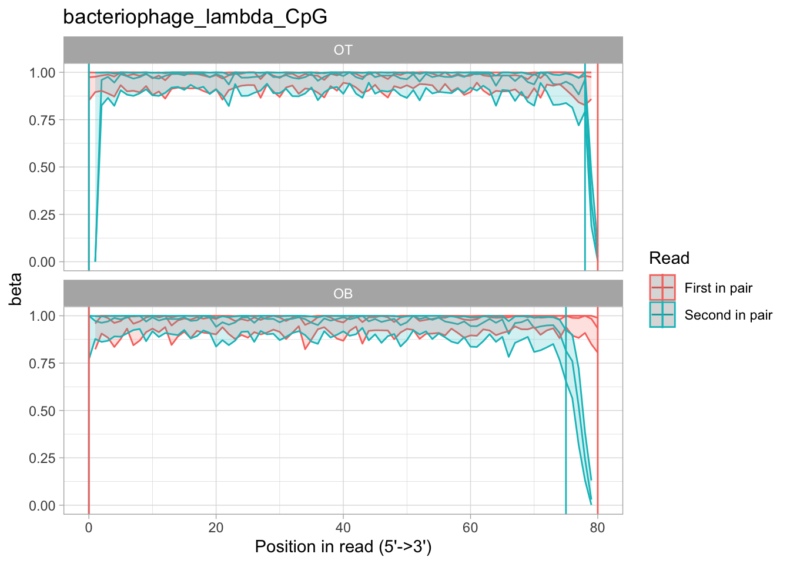
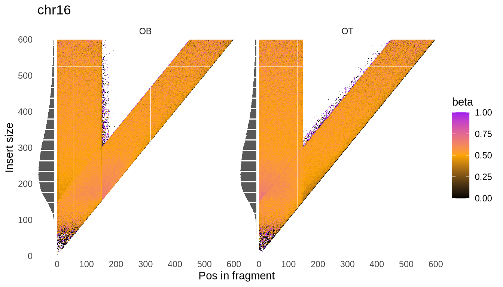
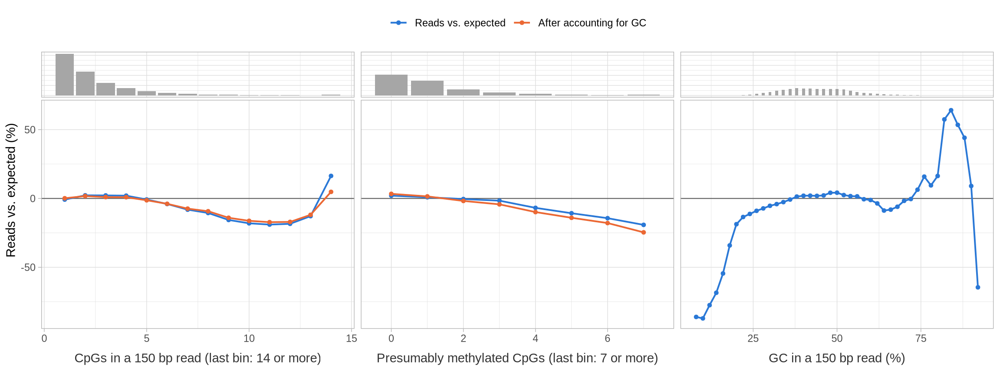
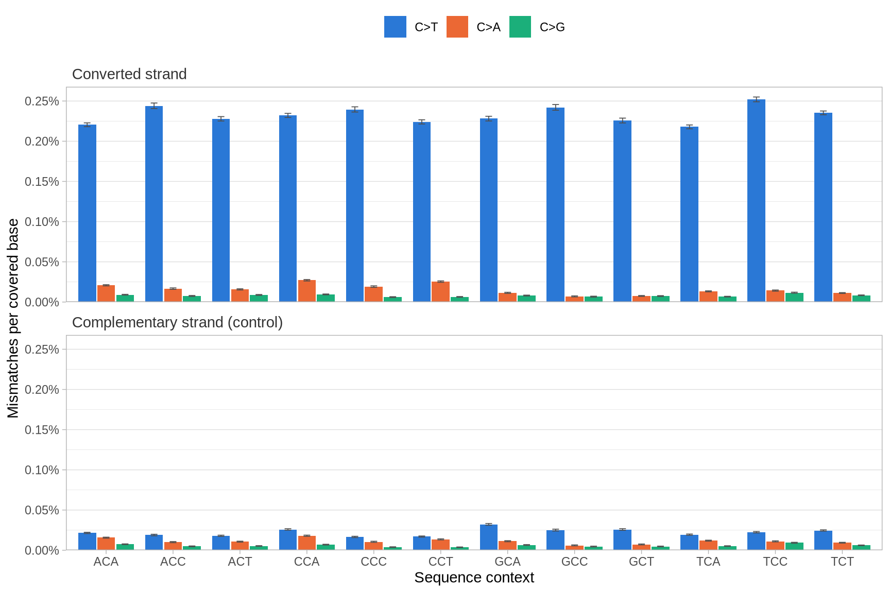

# Quality control report

Rastair comes with a helper script, written in [R](https://cran.r-project.org), which generates a comprehensive QC report for your sequencing library.

> [!NOTE]
> **If not using the docker image:**
> The QC tool requires a working installation of R with [RMarkdown](https://cran.r-project.org/web/packages/rmarkdown/index.html), [data.table](https://r-datatable.com), [ggplot2](https://ggplot2.tidyverse.org) and [argparser](https://cran.r-project.org/web/packages/argparser/index.html) libraries. You can install all of them at once with
> [!NOTE]
> **If not using the docker image:**
> The QC tool requires a working installation of R with [RMarkdown](https://cran.r-project.org/web/packages/rmarkdown/index.html), [data.table](https://r-datatable.com), [ggplot2](https://ggplot2.tidyverse.org) and [argparser](https://cran.r-project.org/web/packages/argparser/index.html) libraries. You can install all of them at once with
> ```r
> install.packages(c("argparser", "data.table", "ggplot2", "rmarkdown"))
> ```
>
> For V-bias, GC-bias and off-target plots, it also requires [Rsamtools](https://bioconductor.org/packages//release/bioc/html/Rsamtools.html) and [ggside](https://cran.r-project.org/web/packages/ggside/index.html). These can be installed with
> ```r
> if (!require("BiocManager", quietly = TRUE))
>   install.packages("BiocManager")
>
> BiocManager::install("Rsamtools")
> install.packages("ggside")
> ```
>
> It also requires [pandoc](https://pandoc.org) for rendering.

## Generating QC reports
The qc report can be generated directly from a bam file, or from pre-generated per-read and per-position bed files:

```bash
mkdir -p test_qc
rastair mbias --output-prefix test_qc --bam test.bam
```

This will produce a file called `qc_report.html` in the `test_qc` directory.

You can selectively disable the V-bias and GC/CpG bias plots to speed up processing and/or reduce dependencies:

```bash
mkdir -p test_qc
rastair mbias --output-prefix test_qc --no-vbias --no-gc --bam test.bam
```

## Elements of the QC report

Conversion of methyl-C to T should be independent of where in a sequencing read the methylation occurred.
However, in reality, a number of experimental procedures can affect the evenness of conversion. For example,
sonication or enzymatic digestion of genomic DNA can produce single-stranded ends. When these are repaired for
A-tailing, the newly synthesized parts will be unmethylated.

To identify any potential issues in your data, we provide several types of plots. The M-bias and V-bias plots investigate the evenness of methylation along reads, the GC/CpG-bias plot shows how coverage depends on sequence context, and the off-target plot estimates conversion outside CpGs:

### M-bias

The classic ["methylation bias"](https://genomebiology.biomedcentral.com/articles/10.1186/gb-2012-13-10-r83) (aka M-bias) plot shows the average methylation per position in a read:



> [!NOTE]
> Unlike other tools, we consistently use 5'&rarr;3' orientation per read, not per reference!

We distinguish between @OT and @OB fragments, and show average methylation for R1 and R2 reads separately. This is an example of an enzymatically fully methylated piece of DNA that we use as a control, so methylation is nearly 100% across most reads. However, you can see that the ends of R2 of OB fragments seem to have lost methylation information. This could be corrected with the [`--nOT` and `--nOB` arguments](./cli.md#filter-options) to `rastair call`.

To facilitate choosing the right cutoff parameters, we also generate a text file for each processed chromosome that contain the estimated optimal `--nOT` and `--nOB` settings, respectively.

In this example, the script produced this:

```bash
cat bacteriophage_lambda_CpG_cutoffs.txt
0,0,0,2
0,0,0,5
```

In other words, it suggested we set `--nOT 0,0,0,2` and `--nOB 0,0,0,5`, i.e. remove the last 2 and 5 bases of R2 in OT and OB, respectively.

### V-bias

In some cases, for example when DNA is enzymatically digested *in vivo* or *in vitro*, there might be a wide range of fragment sizes. We have observed in some instances that fragment size has an impact on methylation bias per read position. To visualise this, we provide what we call a "V-bias" plot:



Here, colour denotes methylation, while the y-axis reflects the length of the original fragment, assuming paired-end sequencing.

### GC/CpG bias

Under random fragmentation, reads start uniformly along the genome, so the number of CpGs a read covers and its GC content should follow those of all read-long windows of the reference (those without `N`).
This plot shows, per number of CpGs and per GC content, how much more (above 0%) or less often reads have it than expected:



Both are taken from the reference under the read, since conversion changes the Cs a read shows.
Only reads with at least one CpG are in the per-read data, so reads and windows are compared among those.
The grey bars show how many reads each bin holds; bins with fewer than 20 reads are left out.
Windows in unmappable sequence are expected but never observed, so CpG counts and GC contents typical of repeats can look under-represented.

GC content and CpG density go together, so a GC bias alone bends the CpG curve too.
The orange line shows what is left of the CpG effect once each reference window is weighted by how over- or under-represented its GC content is among the reads.

In this example (chr21 of a TAPS library of NA12878), the most AT-rich reads are strongly under-represented and the most GC-rich ones over-represented.
Reads with 9 to 13 CpGs are under-represented by up to 20%, and accounting for GC barely changes that, so this deficit is not a GC effect.

The middle panel asks the same of methylation: how often reads cover a given number of presumably methylated CpGs.
The reference has no methylation, so each CpG's methylation level is estimated from a random half of the reads, and a read, like each reference window, presumably holds the sum of its CpGs' levels; only the other half of the reads is counted there, and windows with a CpG that half never covers are left out.
A falling line means regions with many methylated CpGs are under-represented.
It does not tell apart a loss of methylated molecules within a region that is partly methylated, as a read's own methylation calls cannot be compared with the reference.

### Off-target conversion

Conversion should only act on methylated C, which in mammals sits almost exclusively at CpGs.
Rastair calls genetic variants, including those that create a @denovo CpG, so mismatches that remain at non-CpG positions are a mix of sequencing and alignment errors and off-target conversion.
To estimate the latter, the report counts, per sequence context, how often a covered C reads as T, A or G at positions that

- are covered by at least 5 fragments,
- are not part of a CpG,
- are not called as a variant, and show no more alt reads than 2% noise explains (one-sided binomial test, p ≥ 0.01), so a single alt read always counts and a heterozygous variant Rastair did not call does not,
- are at least 3 bp away from any CpG or called variant.



Conversion only acts on the strand that carries the C: @OT reads at a reference C, @OB reads at a reference G.
The other strand sees the same position through the paired G, so a `C>T` there is an ordinary error and serves as a control.
Off-target conversion shows up as `C>T` on the converted strand above both that control and the `C>A`/`C>G` rates in the same context.
In the example above (the same library), `C>T` on the converted strand is about 0.23% in every context, roughly ten times the control.

The mismatch counts come from `rastair call --all`, and the coverage from the read pairs in the BAM, counting overlapping mates once as `call` does.
Both cover `--region` if given, otherwise every mapped contig, like the other plots.
The section needs `--bam` and `--reference`, and is skipped with `--wgbs` or `--no-off-target`.
